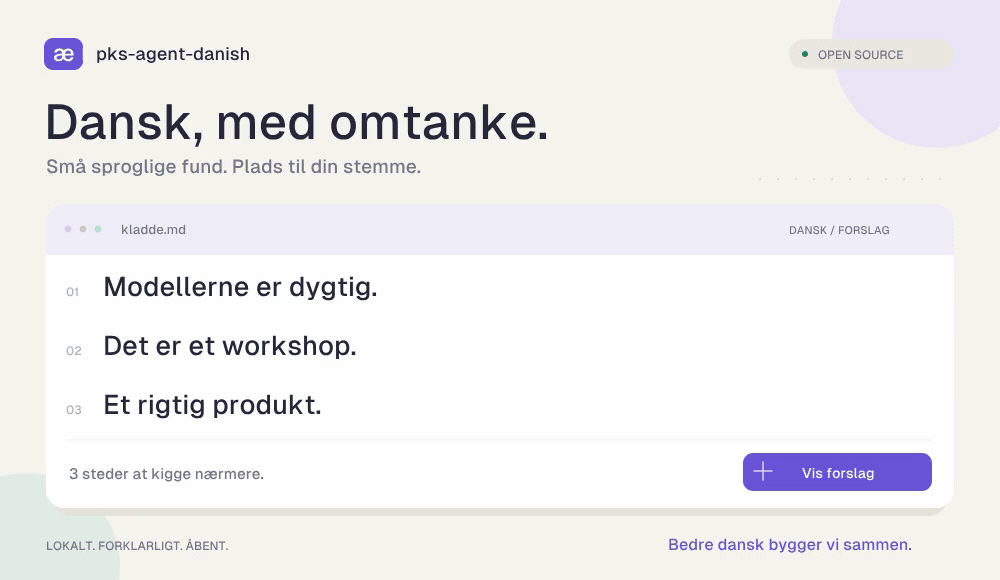

# pks-agent-danish



[](https://github.com/pksorensen/pks-agent-danish/actions/workflows/test.yml)
[](Cargo.toml)
[](#hvor-god-er-den)
[](LICENSE)

**En lokal dansk tekstlinter i Rust. Forklarlige forslag — og plads til din stemme.**

Finder udvalgte stave- og grammatikfejl i Markdown og ren tekst. Kører på
din computer, sender ikke teksten til en tjeneste og ændrer ingen filer.
Målet er et åbent dansk sprogværktøj, som bliver bedre med fælles eksempler,
modeksempler og sprogfaglig viden.

**Alpha:** Den finder reelle fejl, men kan også overse fejl og foreslå noget forkert.
Prøv den på en tekst, du kender, og [fortæl os, om den var nyttig](https://github.com/pksorensen/pks-agent-danish/issues/new?template=feedback.yml).

[Lottie-kilde](docs/assets/danish-lint.json) · [Statisk billede](docs/assets/danish-lint-poster.png) · [Om animationen](docs/animation.md)

## Prøv den

Installér fra kildekode med Rust/Cargo og en C++-compiler (`build-essential`
på Ubuntu, Xcode Command Line Tools på macOS):

```sh
cargo install --git https://github.com/pksorensen/pks-agent-danish --locked
# Hent de fastlåste ordbøger og COR én gang:
danish setup
danish lint din-tekst.md
```

[Native udgivelser](https://github.com/pksorensen/pks-agent-danish/releases)
bygges til Linux og macOS. Windows kan bruge WSL.

CLI, tekstbehandling, grammatikregler, stavning, YAML-regler, installation
og evaluering kører i Rust. **Ingen Python, spaCy, Vale-proces eller
separat Hunspell-installation er nødvendig.** UDPipes C++-bibliotek og vores
DDT-model er indbygget til sætningsanalysen; dette er ikke en påstand om,
at alle tredjepartsafhængigheder er skrevet i Rust.

`danish setup` kræver netværk og henter ordbøger/bøjningsdata med SHA-256-kontrol.
Derefter kører lint offline. Data placeres i operativsystemets lokale
applikationsdatamappe. Vælg en anden mappe med `--resources` eller
`PKS_DANISH_RESOURCES`; ingen tekst uploades.

Prøv uden at oprette en fil:

```sh
danish lint - <<'TEXT'
Modellerne er dygtig. Det er et workshop.
TEXT
```

```text
warning[Danish.PredicateAgreement]: Tillægsordet skal passe til 'Modellerne'; overvej 'dygtige'.
warning[Danish.ArticleGender]: 'workshop' har fk-køn i COR; overvej 'en'.
```

Outputtet ovenfor er forkortet; CLI'en viser også fil, linje og kolonne.
Animationen illustrerer forslagene. Produktet er en CLI og har ikke en grafisk editor.

## Hvad finder den?

| Eksempel | Forslag |
| --- | --- |
| Modellerne er **dygtig**. | dygtige |
| Det er **et** workshop. | en |
| Et **rigtig** produkt. | rigtigt |
| Hun **reparere** cyklen. | reparerer |
| Han **plejedede** at komme. | plejede |

Motoren kombinerer Stavekontroldens ordbog via Rust-biblioteket Spellbook,
Dansk Sprognævns COR og en model trænet på det åbne danske DDT-korpus.
Reglerne undersøger afgrænsede konstruktioner. Der er endnu ingen fuld
kommakontrol eller forståelse af hele tekstens betydning. Stil- og
terminologipakker er tilvalg.

```sh
danish lint --format json artikel.md
danish lint --checks grammar artikel.md
danish lint --profile klart-sprog artikel.md
danish lint --dictionary vocabularies/development.txt artikel.md
danish explain Danish.PredicateAgreement
```

[CLI, profiler og undtagelser](docs/usage.md) · [Grammatikregler](docs/grammar.md) · [Regelkatalog](docs/rules.md)

## Hvor god er den?

Alle **84 regeleksempler og 61 kvalitetseksempler består** i Rust-versionen.
På 180 blogindlæg fandt den 83 advarsler. Den bevarer alle 24 stavefund og
49 af de 50 tidligere vurderede nyttige fund fra Python-prototypen.

Udviklerens gennemgang vurderer 56 fund som nyttige, 6 som delvise,
20 til videre sprogfaglig vurdering og 1 som forkert. Det er en åben
udviklergennemgang, ikke et uafhængigt mål for dansk korrekthed.

[Evaluering af Rust-porteringen](docs/rust-migration.md) · [Python-prototypens evaluering](docs/evaluation.md)

Testmaterialet er brugt under udviklingen og er ikke et uafhængigt benchmark.
Dækningen af samtlige fejl er ikke målt. Tekniske låneord er en kendt fejlkilde.

## Byg bedre dansk sammen med os

Du behøver ikke kunne kode for at hjælpe:

- **[En forkert advarsel](https://github.com/pksorensen/pks-agent-danish/issues/new?template=false-positive.yml)** — vis en sætning, vi skal lade være.
- **[En fejl vi overser](https://github.com/pksorensen/pks-agent-danish/issues/new?template=rule.yml)** — vis fejlen og den ønskede rettelse.
- **[Erfaringer fra din tekst](https://github.com/pksorensen/pks-agent-danish/issues/new?template=feedback.yml)** — hvad hjalp, hvad støjede, og ville du bruge den igen?

Issues er offentlige, så brug korte, anonymiserede eksempler. Vi søger især
sprogfaglige reviewers og folk, der skriver andre typer tekster end tekniske blogs.

Simple mønstre kan bidrages i YAML; grammatikregler bruger Rust og sproglige
analyser. Hver regel skal have en kilde, fejl, korrekte modeksempler og kendte
undtagelser. Se [bidragsvejledningen](CONTRIBUTING.md).

```sh
cargo build --locked
target/debug/danish setup
cargo test --locked -- --test-threads=1
target/debug/danish catalog --check
```

## Licens og inspiration

Inspireret af [english-rs](https://github.com/Aaryan-Kapoor/english-rs).
Kode, selvstændige regler og animation er [MIT-licenseret](LICENSE).
Ordbøger, analysemodel, native biblioteker og skrifttype har egne licenser —
se [THIRD_PARTY.md](THIRD_PARTY.md). Den medfølgende model er CC BY-SA 4.0 og
kan også bruges kommercielt under licensens vilkår.
